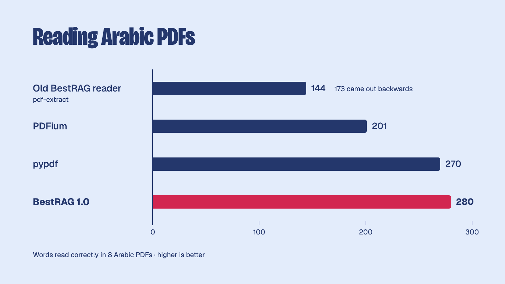

# BestRAG


[](https://pypi.org/project/bestrag/)

[](https://github.com/samadpls/BestRAG/blob/main/LICENSE)
[](https://github.com/samadpls/BestRAG/actions/workflows/test.yml)

BestRAG stores your documents in [Qdrant](https://qdrant.tech/) and searches them in two ways at once: by meaning (dense vectors) and by exact words (BM25). It merges the two result lists, and it can rerank the best results with a cross-encoder. All of this runs in Rust, and you use it from Python.

## ✨ What it does

- **Hybrid search.** Dense vectors find passages that mean the same thing as your question. BM25 finds exact words, names and codes like `XJ-9042`, which dense search often misses. Qdrant merges both lists with reciprocal rank fusion (RRF).
- **Optional reranking.** A cross-encoder can read your question together with each candidate and put the best one first. It is off by default, because it makes each search much slower; turn it on when the last bit of ranking quality matters.
- **PDFs and plain text.** PDFs are read page by page, and every result keeps its page number. Indexing a name again replaces the old version, so you never get duplicates.
- **Rust underneath.** You call Python, and Rust does the PDF reading, chunking, embeddings and Qdrant calls. Python's lock is released during this work, so your other threads keep running.
- **Arabic and other languages.** PDFs are read in true reading order, so Arabic does not come out backwards and ligatures like لا stay whole. BM25 treats spelling variants such as الإجازة and الاجازة as the same word. Chunks are measured with the model's own tokenizer, so no text is cut off silently. See [Languages](#languages).

## 🚀 Install

With [uv](https://docs.astral.sh/uv/) (recommended):

```bash
uv add bestrag            # in a uv project
uv pip install bestrag    # in any environment
```

With pip:

```bash
pip install bestrag
```

Wheels are built for Linux (x86_64 and arm64), macOS on Apple Silicon (macOS 14 or newer) and Windows (x64), for Python 3.10 and newer. On other systems, uv or pip builds BestRAG from source, which needs [Rust](https://rustup.rs/).

You also need a Qdrant server. You can run one locally with Docker, or use the free tier of [Qdrant Cloud](https://cloud.qdrant.io/):

```bash
docker run -p 6333:6333 -p 6334:6334 qdrant/qdrant
```

## Usage

```python
from bestrag import BestRAG

rag = BestRAG("http://localhost:6334", "my-docs")

rag.add_pdf("handbook.pdf")
rag.add_text("Part XJ-9042 replaces the filter in the 2019 pump.", "parts", {"team": "support"})

for hit in rag.search("which filter fits the old pump?", limit=5):
    print(f"{hit['score']:.2f}  {hit['source']}  page {hit['page']}  {hit['text'][:60]}")

rag.delete("parts")
```

Each hit is a dict with `text`, `score`, `source`, `page` and `metadata`, with the best hit first. The first `BestRAG(...)` call downloads the embedding model, about 130 MB, and later calls reuse it.

BestRAG talks to Qdrant over gRPC, so use port **6334**, not the REST port 6333. For Qdrant Cloud, pass your cluster URL with `:6334` and `api_key="..."`.

To index many documents, use `add_texts`. It embeds them in batches, so it is much faster than calling `add_text` in a loop:

```python
rag.add_texts([
    {"name": "faq-1", "text": "How do I reset my password? ..."},
    {"name": "faq-2", "text": "Can I change my plan later? ...", "metadata": {"lang": "en"}},
])
```

## Languages

BestRAG keeps text in any script, but its default models are English models. For other languages, choose multilingual ones:

```python
rag = BestRAG(
    "http://localhost:6334",
    "hr-docs",
    dense_model="intfloat/multilingual-e5-small",  # or "BAAI/bge-m3": stronger, but about 2 GB
    reranker="jinaai/jina-reranker-v2-base-multilingual",
)
```

Arabic PDFs are hard for most text extractors. This is what BestRAG does about the common problems:

| Problem | What BestRAG does |
| --- | --- |
| Many PDFs store Arabic in visual order, so extractors return it backwards. | It reads each glyph's position and rebuilds every line in reading order. |
| The lam-alef ligature (لا, لإ) gets swapped or split. | It moves whole glyphs, not single letters, so the ligature keeps its order. |
| Punctuation ends up at the wrong end of the sentence. | Full stops and commas follow the line's direction. |
| A search misses a word written with or without hamza or short vowels. | BM25 normalises them the way Lucene's Arabic analyzer does, so الإجازة matches الاجازة. |
| Arabic needs more tokens per word, so fixed-size chunks get cut off. | It checks every chunk with the model's tokenizer and splits it when it is too long. |

On 8 real Arabic PDFs, BestRAG read the most common words correctly, and none came out backwards:



The tests include an Arabic PDF that checks each of these cases.

Two things BestRAG cannot fix:

- **No ToUnicode map:** some PDFs have fonts with no map from glyphs to letters. They hold only shapes, so the pages need OCR before indexing.
- **Questions with no answer:** BestRAG ranks results, but it does not decide whether a question has an answer at all. A score cutoff for that has to be tuned for each language and model.

<details>
<summary><b>All options</b></summary>

`BestRAG(url, collection, *, api_key=None, dense_model="BAAI/bge-small-en-v1.5", reranker=None, cache_dir=None)`

| Option | What it does |
| --- | --- |
| `url` | Qdrant's gRPC address, usually ending in `:6334` |
| `collection` | The Qdrant collection. BestRAG creates it if it does not exist. |
| `api_key` | The Qdrant API key, for Qdrant Cloud or a secured server. It never appears in `repr()`. |
| `dense_model` | Any text embedding model that [fastembed](https://github.com/Anush008/fastembed-rs) supports. A collection keeps the model it was created with. |
| `reranker` | Off (`None`) by default. Pass any fastembed reranker to turn it on: `"jinaai/jina-reranker-v1-turbo-en"` is small and English, and `"jinaai/jina-reranker-v2-base-multilingual"` covers other languages. |
| `cache_dir` | Where models are downloaded. The default is `$BESTRAG_CACHE_DIR`, then your user cache folder. If `$HF_HOME` is set, fastembed uses it instead. |

| Method | What it does |
| --- | --- |
| `add_pdf(path, name=None, metadata=None)` | Indexes a PDF page by page. `name` defaults to the file name. |
| `add_text(text, name, metadata=None)` | Indexes plain text. |
| `add_texts(documents)` | Indexes a list of `{"name", "text", "metadata"}` dicts in batches. |
| `search(query, limit=10, mode="hybrid")` | Returns up to `limit` hits. `mode` can be `"hybrid"`, `"dense"` or `"sparse"` (BM25 only). |
| `delete(name)` | Removes everything stored under `name`. |
| `count(name=None)` | Counts stored chunks, for one name or for the whole collection. |

Errors from BestRAG raise `bestrag.BestRAGError`.

</details>

## How well it works

We measured BestRAG on [BEIR SciFact](https://huggingface.co/datasets/BeIR/scifact): 5,183 scientific abstracts and 300 test questions, where experts marked the abstracts that answer each question. Each search asked for 10 results.


| Setup | nDCG@10 | Recall@10 | Median search time |
| --- | --- | --- | --- |
| BM25 only | 0.655 | 0.764 | 0.2 ms |
| Dense only | 0.715 | 0.821 | 8 ms |
| **Hybrid (dense + BM25, RRF), the default** | **0.734** | **0.860** | **7 ms** |
| Hybrid + reranker (optional) | 0.754 | 0.864 | 0.8 s |

- **Hybrid search finds more of the right abstracts** than either search alone. Recall@10 rises from 0.821 with dense only to 0.860.
- **The optional reranker puts the right abstracts a little higher.** nDCG@10 rises from 0.734 to 0.754, but each search takes about 0.8 seconds instead of 7 ms. So it is off by default.
- **The dense-only score is a sanity check.** 0.715 is close to the 0.713 that the model's authors report for SciFact on its [model card](https://huggingface.co/BAAI/bge-small-en-v1.5). Dense-only is also what version 0.3 did in practice, because its BM25 vectors were never searched.
- **Indexing** all 5,183 abstracts (7,088 chunks) took about 5 minutes with `add_texts`.

Compared with version 0.3.3, on the same 40-page PDF with the default settings:

| | 0.3.3 | 1.0 |
| --- | --- | --- |
| Median search time | 16 ms | **5.6 ms** (2.8 times faster) |
| Time to index the PDF | 5.7 s | 5.8 s |
| Share of the text it indexes | 49% (each page was cut at 512 tokens) | **100%** |
| Peak memory | 688 MB | 864 MB |

Version 1.0 indexes twice as much text in the same time. It uses a little more memory, mostly because it loads the full-precision embedding model and embeds in batches.

<details>
<summary><b>How we measured</b></summary>

- **Machine:** a MacBook Pro, CPU only, with Qdrant 1.20.2 running locally.
- **Models:** `bge-small-en-v1.5` for dense vectors (the default) and `jina-reranker-v1-turbo-en` for the reranker row.
- **Metrics:** nDCG@10 rewards putting the right abstracts near the top. Recall@10 is the share of right abstracts found in the top 10. When one abstract fills two chunks in the top 10, it counts once.
- **Search time:** the median time per question, measured from Python.
- **Reproduce:** run `eval/scifact.py`, as described in [CONTRIBUTING.md](https://github.com/samadpls/BestRAG/blob/main/CONTRIBUTING.md).

</details>

<details>
<summary><b>How it works</b></summary>

**Indexing.** PDF text is rebuilt line by line from glyph positions, so right-to-left scripts come out in reading order. Text is split into chunks of 200 words with a 40-word overlap. A short tail joins the last chunk, so no chunk is tiny. Any chunk that is longer than the model can read is split again. Each chunk gets two vectors:

1. a dense vector from the embedding model, stored as `dense`;
2. a BM25 vector, stored as `bm25`. Qdrant's IDF modifier adds the inverse document frequency on the server.

Indexing a name first deletes what was stored under it before, so re-indexing a file never creates duplicates.

**Search.** Qdrant runs the dense search and the BM25 search together and merges them with RRF. If you turn on a reranker, it scores the top `max(3 × limit, 30)` results again, and BestRAG returns the best `limit`.

</details>

## 🤗 Try it on Hugging Face Spaces

You can try BestRAG in your browser on [Hugging Face Spaces](https://huggingface.co/spaces/samadpls/BestRAG). Bring your own Qdrant URL and API key.

## Upgrading from 0.3

Version 1.0 is a rewrite with a new API. It cannot read collections made by 0.3, so please index your documents again. The old pure-Python code is kept at the [`v0.3.3` tag](https://github.com/samadpls/BestRAG/tree/v0.3.3), and it is no longer maintained.

## Contributing

Contributions are welcome. [CONTRIBUTING.md](https://github.com/samadpls/BestRAG/blob/main/CONTRIBUTING.md) explains how to build the project, run the tests and run the evaluation.

## License

[MIT](https://github.com/samadpls/BestRAG/blob/main/LICENSE). Made by [Abdul Samad](https://samadpls.com).
